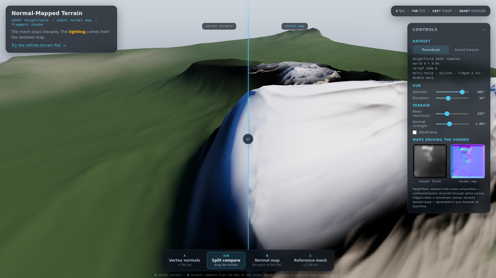
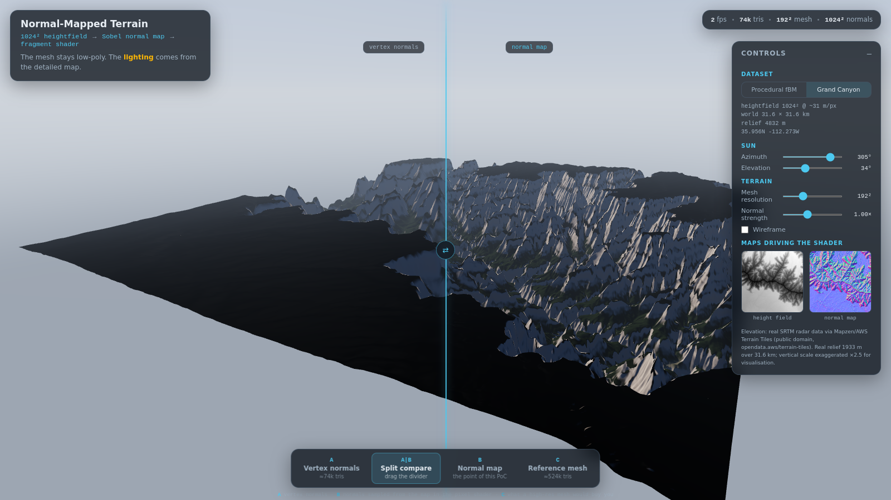

# Normal-Mapped Terrain — a Three.js PoC

**Claim:** a *low-poly* terrain mesh can look dramatically more detailed if the
pixel shader takes its normals from a **normal map baked from a high-resolution
heightfield**, instead of using interpolated vertex normals.

This repo now contains **two** proof-of-concepts:

| Page | Claim |
|---|---|
| [`index.html`](index.html) | A low-poly *finite* terrain lit by a high-resolution baked normal map beats `computeVertexNormals()` at a fraction of the triangles. |
| [`infinite.html`](infinite.html) | The same heightfield → float-Sobel → object-space-normal pipeline can drive camera-centred **clipmap rings** over an effectively infinite world, with heights displaced in the vertex shader and normals sampled from a toroidal tile cache. |

The first PoC is described below; the infinite-terrain PoC has its own
[concept/implementation doc](docs/INFINITE_TERRAIN_CONCEPT.md) and a
[section further down](#infinite-terrain--clipmap--toroidal-tile-cache).

---

This repo is the proof. Open the demo, switch to **Split compare**, and drag
the divider across the same mesh:

| Side | Normals from | Detail (measured) |
|---|---|---|
| Left — A | `computeVertexNormals()` on a 192² mesh | baseline |
| Right — B | Sobel-baked 2048² normal map, sampled per-pixel | **7–20× more high-frequency shading detail** |

Both halves render the *exact same triangles* (≈74k). No extra geometry, no
tessellation — just better normals in the fragment shader.



## The pipeline

```
heightfield (float, 2048²)  ──Sobel──▶  normal map (RGB, object-space)
        │
        └─bilinear downsample─▶  mesh (192², vertex normals = baseline "A")
```

1. **Heightfield** — either seeded **fBM Perlin + ridged multifractal + domain
   warping** (generated in the browser at load time), or **real SRTM radar
   data** of the Grand Canyon (pre-processed from the public Mapzen/AWS
   terrain tiles, committed as uint16 + metadata).
2. **Normal map** — Sobel-filtered gradient of the float heightfield, in *real
   world units* (`dh/dx` in metres/metres), so the baked normals are an honest
   description of the terrain, not an artistic exaggeration (the *Normal
   strength* slider does the exaggerating, if you want it).
3. **Mesh** — a regular grid displaced by bilinear sampling of the same
   heightfield; `computeVertexNormals()` gives the classic smooth-but-blobby
   baseline.
4. **Shader** — a custom `ShaderMaterial`. The money line in the fragment
   shader:

   ```glsl
   vec3 nm = texture2D(uNormalMap, vUv).xyz * 2.0 - 1.0; // (x, z, up)
   vec3 mapN = normalize(vec3(nm.x * uNormalStrength, nm.z, nm.y * uNormalStrength));
   vec3 N    = normalize(mix(vNormalW, mapN, uNormalBlend)); // vertex ➜ map
   ```

   Because the terrain is an unrotated heightfield, the map is encoded in the
   terrain's local frame (R = east, G = south, B = up) and needs **no TBN
   matrix** — immune to tangent-space mismatch problems that plague normal
   mapping on arbitrary meshes.

## Modes

| Mode | What you see |
|---|---|
| **A — Vertex normals** | Low-res mesh, three.js vertex normals. The baseline. |
| **Split compare** | Same mesh twice via scissor rendering; left A, right B. Drag the divider. |
| **B — Normal map** | Same mesh, normals from the baked map. **The point of the PoC.** |
| **C — Reference mesh** | A 1024² (≈2.1M tris) mesh with true geometric detail — the ground truth B is judged against. |

Measured high-frequency shading detail on the default procedural scene:
`A = 1.8  <  B = 2.9  ≈  C = 3.1` — mode B recovers ≈92% of the reference
mesh's perceived detail with **3.5% of its triangles**.


*(Grand Canyon dataset: real SRTM elevation, vertical scale ×2.5 for visualisation)*

## Honest limitations (why this isn't free lunch)

- **Silhouettes don't lie.** Normal maps fake shading, not geometry — the
  horizon and ridge crests at grazing angles still show the coarse mesh
  facets. Only displacement/tessellation fixes that.
- **No self-shadowing from fine detail.** Cast shadows would come from mesh
  geometry, so they'd look smoother than the direct lighting.
- **Aliasing under motion.** High-frequency normals can shimmer; standard
  mipmapping (which we use) softens but does not perfectly solve it —
  mip-filtered normal maps should technically be variance-corrected.
- **Precision matters.** Deriving the normal map from an 8-bit heightmap
  causes terracing; that's why this pipeline computes normals from the
  *float* field and only quantises the (unit-length) normals themselves.

## Infinite terrain — clipmap + toroidal tile cache

[](https://mode777.github.io/normalmapped-terrain/infinite.html)

The second PoC asks a different question: can the *same* normal-map trick
work when the terrain never ends?

- **Geometry** — one centre block plus 7 nested square rings, spacing
  `16 m · 2^L`. Each ring is a fixed grid; heights are displaced in the
  vertex shader. Total ≈ 122k triangles, 4 draw calls. The mesh is
  deliberately coarser than the first PoC.
- **LOD seams** — a zero-width 2:1 stitch strip at every ring edge. The fine
  edge samples LOD `L`; the coarse chord samples LOD `L+1` with the same UV
  mapping as the next ring, so the two meshes are watertight. A final skirt
  and fog hide the 49 km horizon.
- **Texture buffer** — a `DataArrayTexture` per map, one layer per LOD.
  Height is `R16F`; normals are `RGBA8` baked at **4×** the height-tile
  resolution (256² normal tiles from a 64² height tile, 1024² cache per
  layer). A 4×4-tile toroidal cache follows the camera.
- **Tiles** — two Web Workers generate 64×64 height tiles and 256×256 normal
  tiles on demand, with a one-tile prefetch margin. Uploads use direct
  `texSubImage3D`.
- **Flight** — pointer-lock free-fly (`WASD`, `Q/E`, `Shift`, wheel) plus an
  optional auto-cruise. A floating origin keeps the shader's tile phase
  stable after long flights.
- **Debug views** — LOD colours, wireframe, and a world-space tile-grid
  checkerboard.

Controls and QA:

```bash
npm run dev                         # open /infinite.html
npm run test:infinite               # Node-only tile/LOD math checks
npm run build && npx vite preview   # serve dist/ on :4173

npm install --no-save puppeteer-core
node tools/screenshot-infinite.mjs --url http://127.0.0.1:4173/infinite.html --out shots-infinite
node tools/analyze-infinite.mjs shots-infinite
```

The headless QA verifies 112 resident tiles at boot, no console/page errors,
warps to 25 km and 500 km, and measures the normal-map contribution:
`hf = 2.79` with the map vs `0.23` with flat normals on the same view —
roughly 12× more high-frequency shading detail, now with a 4× normal-to-mesh
resolution ratio.

Honest limitations: the far rings are coarse (up to 1024 m vertex spacing at
LOD 6), so silhouettes are smooth even though shading detail is not; the
world ends at 49 km behind fog; and tile generation is CPU-bound in workers.

## Documentation

| Doc | What's inside |
|---|---|
| [AGENTS.md](AGENTS.md) | Orientation for AI coding agents: repo map, commands, critical invariants (coordinate/encoding conventions), practices |
| [docs/PIPELINE.md](docs/PIPELINE.md) | The math: heightfield → Sobel → world-space normals, the no-TBN encoding, strength-slider equivalence, split rendering, SRTM/terrarium decoding, limitations |
| [docs/INFINITE_TERRAIN_CONCEPT.md](docs/INFINITE_TERRAIN_CONCEPT.md) | The second PoC: clipmap rings, 2:1 stitching with fine/coarse layers, toroidal tile cache, floating origin, decisions and measured results |
| [docs/VERIFICATION.md](docs/VERIFICATION.md) | Repeatable headless QA (`tools/screenshot.mjs` + `tools/analyze-shots.mjs`), acceptance metrics, manual test pass |

## Data sources

- **Procedural:** seeded improved Perlin noise (in-house `src/perlin.js`),
  fBM 6 octaves + ridged multifractal 8 octaves + domain warp, 2048² samples,
  deterministic per seed.
- **Grand Canyon:** NASA/NGA SRTM 1-arc-second radar elevation via the
  public [Mapzen / AWS Terrain Tiles](https://registry.opendata.aws/terrain-tiles/)
  (terrarium encoding, public domain). `tools/build-real-terrain.mjs`
  downloads, stitches, crops and normalises it:

  ```bash
  npm install
  npm run terrain:grand-canyon          # rebuild public/data/*
  # or another spot:
  node tools/build-real-terrain.mjs --name matterhorn --lat 45.9763 --lon 7.6586
  ```

## Develop / build / deploy

```bash
npm install
npm run dev             # local dev server (index.html + infinite.html)
npm run build           # static site in dist/
npm run test:infinite   # Node-only tile/LOD math checks
npm run deploy          # build + push dist/ to the gh-pages branch
```

Live at: **https://mode777.github.io/normalmapped-terrain/**

Infinite terrain: **https://mode777.github.io/normalmapped-terrain/infinite.html**

## Repo map

```
AGENTS.md            orientation for AI coding agents (repo map + invariants)
docs/PIPELINE.md     the math behind baking and shading
docs/INFINITE_TERRAIN_CONCEPT.md  clipmap/tile-cache concept + results
docs/VERIFICATION.md headless QA recipe + acceptance metrics
src/perlin.js        seeded improved Perlin + fBM + ridged multifractal
src/terrain-data.js  dataset builders (procedural + SRTM loader), bilinear sampler
src/normalmap.js     Sobel normal-map baking in world units   ← the core
src/geometry.js      displaced grid mesh + computeVertexNormals (baseline)
src/shaders.js       the custom vertex/fragment shaders       ← the core
src/main.js          scene, modes, split rendering, sun, stats
src/ui.js            control panel wiring
src/infinite/        second PoC: heightfield worker, toroidal tiles, clipmaps,
                     flight controller, infinite shaders/UI
infinite.html        second PoC entry page
tools/               real-data preprocessing + unit checks + headless QA drivers
public/data/         committed Grand Canyon heightfield + metadata
```

## License

MIT — see [LICENSE](LICENSE). The Grand Canyon elevation data is derived
from NASA/NGA SRTM via Mapzen/AWS Terrain Tiles (public domain).

