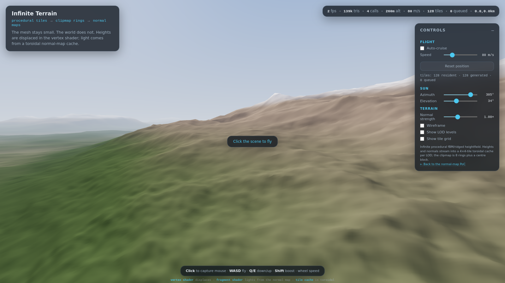
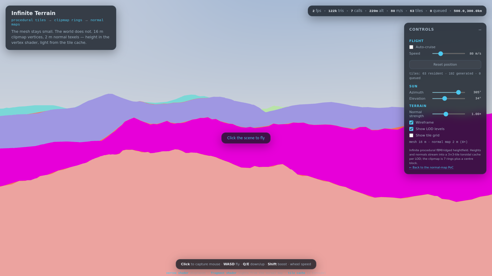
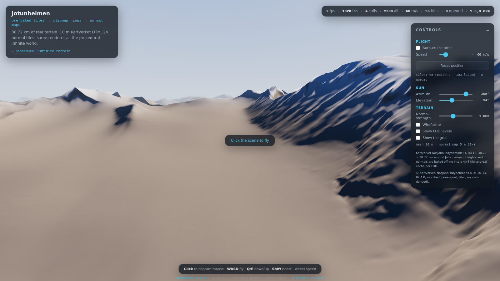

# Normal-Mapped Terrain — Clipmap PoCs

**Claim:** a small set of camera-centred clipmap rings can render a landscape
if heights are displaced in the vertex shader from a toroidal tile cache and
the lighting normals come from per-pixel normal maps baked from the same float
heightfield. The same renderer works for both a procedural world and a
checked-in real DEM.

Two terrain pages share one texture-backed clipmap renderer; a third page shows
the packed material library:

| Page | Dataset | What it proves |
|---|---|---|
| [`infinite.html`](https://mode777.github.io/normalmapped-terrain/infinite.html) | Seeded procedural height function, streamed by workers | An effectively infinite world from a small mesh |
| [`dem.html`](https://mode777.github.io/normalmapped-terrain/dem.html) | Kartverket DTM 10, Jotunheimen, checked in as height/normal tiles | The same renderer consumes offline-baked real terrain with textured materials |
| [`materials.html`](https://mode777.github.io/normalmapped-terrain/materials.html) | Poly Haven CC0 library, packed offline | Asset-level albedo/slope QA for the 20-material set |

[](https://mode777.github.io/normalmapped-terrain/infinite.html)

## Infinite procedural page

- **Small mesh, huge world** — one centre block plus nested square rings,
  spacing `2 m · 2^L` for 10 LODs. About 165k triangles and 4 draw calls
  cover roughly 49 km to the fogged horizon.
- **Detail beyond the mesh** — normal maps are baked at **8×** the height-tile
  resolution: 0.25 m normal texels against 2 m near-field vertices. On the
  same view the normal map adds an order of magnitude more high-frequency
  shading detail than flat normals.
- **Streaming without a hitch** — two Web Workers generate 64×64 height tiles
  and 512×512 normal tiles on demand; a 4×4 toroidal cache per LOD covers the
  visible ring plus prefetch margin.



## How it works

- **Geometry** — one centre block plus nested rings. Heights are displaced in
  the vertex shader; the CPU never builds a full terrain mesh.
- **LOD snapping** — every ring's origin snaps to **its own** spacing, so a
  coarse ring is rigid between snaps instead of re-sampling its height tile
  every frame (the "swimming" a shared origin causes). Rings are padded by one
  cell and clipped to the parent's outer square, so boundaries stay watertight
  without stitch geometry; the outer few cells morph into the next-coarse
  mesh. A final skirt and fog hide the horizon.
- **Texture buffer** — a `DataArrayTexture` per map, one layer per LOD.
  Height is `R16F`; normals are `RGBA8` baked from float heights at 8× the
  height-tile resolution (2048² cache per layer — the WebGL2 ceiling).
- **Tiles** — a toroidal `4×4` cache per LOD. Until a tile is replaced, world
  tile `(tx,ty)` always lives in slot `(tx mod 4, ty mod 4)`; the shader
  reproduces the mapping. Uploads use direct `texSubImage3D`.
- **Shading** — object-space normals (`R = east`, `G = south/+z`, `B = up`)
  decoded without a TBN matrix; the terrain is an unrotated heightfield, so
  local frame equals world frame.
- **Flight** — pointer-lock free-fly (`WASD`, `Q/E`, `Shift`, wheel) plus an
  optional auto-cruise. A floating origin keeps the shader's tile phase stable
  after long flights.
- **Debug views** — LOD colours, wireframe, and a world-space tile-grid
  checkerboard.

## Pre-baked Jotunheimen DEM

[](https://mode777.github.io/normalmapped-terrain/dem.html)

`dem.html` renders a 30.72 km × 30.72 km window of Jotunheimen from
Kartverket's **Nasjonal høydemodell DTM 10**. The height and normal tiles are
baked offline by `tools/bake-dem.ts`, checked into
`public/data/jotunheimen/`, and streamed through the same `TileCache` and
`ClipmapRenderer` as the procedural page.

- **Source:** Kartverket DTM 10 via the Geonorge WCS, EPSG:25833, CC BY 4.0.
- **Grid:** 10 m, 6 LODs, 2× normal resolution, 5×5 cache, 3,080 tiles,
  ~101 MB checked in. The 2× normal PNGs dominate the size; the fragment
  shader biases each ring to the next-finer normal layer for sharper distant
  shading.
- **Bake tool:** Node + `geotiff` + `proj4` + `pngjs`; no GDAL. All LODs come
  from one height grid, and normals use a one-texel halo so tile edges are
  continuous.
- **Finite world:** the camera free-flies without a boundary; the source
  clamps out-of-range tile requests to the nearest edge tile, and fog/last-ring
  skirt hide the dataset edge.
- **Attribution:** © Kartverket, Nasjonal høydemodell DTM 10, CC BY 4.0,
  modified (resampled, tiled, normals derived). See
  [docs/DEM_DATASET.md](docs/DEM_DATASET.md).
- **Material textures:** [Poly Haven](https://polyhaven.com/) CC0 assets,
  packed and resampled. See [public/materials/README.md](public/materials/README.md).

## Textured material layer

The DEM page replaces the flat height/slope color bands with a checked-in
Poly Haven library and a baked four-slot distribution:

- **20 materials** (24 cap), packed as 512² RGBA8 albedo+height and
  slope+roughness+AO arrays. Physical tile sizes come from Poly Haven's
  recorded dimensions.
- **Baked stack** — a 2048² map of four material IDs and four normalized
  weights over the 30.72 km window, plus a 1024² macro albedo for the far
  field. The weight rules are steepness-driven rock/cliff, scree on moderate
  slopes, snow on high north-facing ground and grass in low concavities.
- **Shading** — height-blended albedo, material normals composed as a slope sum
  (no TBN), triplanar projection for rock only, and distance fade to the macro
  albedo. The material-off path preserves the old palette.
- **First-slice palette** — Jotunheimen uses `rock_face_03`, `gravelly_sand`,
  `snow_02` and `sparse_grass`; the other 16 materials are for the synthetic
  biome world in the follow-up change.

[materials.html](https://mode777.github.io/normalmapped-terrain/materials.html)
shows every packed albedo/slope pair. `dem.html` exposes material
on/off/debug, height-blend and material-normal controls.

## Infinite page controls

The DEM page uses the same controls, with a fixed-radius auto-cruise orbit
instead of the unbounded wander.

| Input | Action |
|---|---|
| Click the scene | capture the mouse |
| `WASD` | fly horizontally |
| `Q` / `E` | descend / climb |
| `Shift` | boost |
| Mouse wheel | change flight speed |
| Panel | auto-cruise, speed, reset, sun, normal strength, wireframe, LOD/tile debug |
| Panel → Materials → Mode | material on / off / debug weight view |
| Height blend | bias material boundaries by the packed height |
| Material normals | scale the material slope contribution |

## Verification

```bash
npm run test:infinite               # Node-only tile/LOD/normal math checks
npm run test:dem                    # synthetic + checked-in DEM dataset checks
npm run test:materials              # packed Poly Haven library checks
npm run build && npx vite preview   # serve dist/ on :4173

npm install --no-save puppeteer-core
node tools/screenshot-infinite.ts \
  --url http://127.0.0.1:4173/infinite.html --out shots-infinite
node tools/analyze-infinite.ts shots-infinite

node tools/screenshot-dem.ts \
  --url http://127.0.0.1:4173/dem.html --out shots-dem
node tools/analyze-dem.ts shots-dem
```

The infinite headless QA verifies 160 resident tiles after streaming settles,
no console/page errors, warps to 25 km and 500 km, a magenta-background crack
test, and measures the normal-map contribution against flat normals with an
8× normal-to-mesh resolution ratio. The DEM loop verifies the 3,080-tile
dataset, an orbit/warp, LOD/tile debug, a boundary view, the crack test, and the
material set: on/off, boundary, cliff, distance, debug/weight view and the
swatch page. `test:dem` and `test:materials` are the network-free data gates.
See [docs/VERIFICATION.md](docs/VERIFICATION.md) for the full recipe and
reference values.

Default CI runs `npm run test:infinite`, `npm run test:dem`,
`npm run test:materials` and `npm run build`. The screenshot comparison loops
are intentionally **not** part of the Actions deployment; use the SSH
verification host when debugging a visual regression or comparing screenshots.

## Honest limitations

- The far rings are coarse (up to 1024 m vertex spacing at LOD 9), so
  silhouettes are smooth even though shading detail is not.
- The world ends at 49 km behind fog; that is the configured view distance,
  not a truly infinite mesh.
- Normal maps are RGB8, so extreme grazing-angle lighting can still show
  quantisation/aliasing.
- Tile generation is CPU-bound in workers; a cold boot on a slow phone can
  take several seconds. The 8× normal cache costs ~160 MiB of GPU texture
  memory (the CPU-side buffer is freed after allocation).
- The cache is exactly 2048 texels per side — the WebGL2 ceiling — which is
  why the spacing was reduced instead of growing it.
- The DEM scene is a finite 30.72 km window of 10 m data. Its 2× normal map is
  interpolated from the same 10 m heights, so it smooths shading but does not
  invent survey detail. The checked-in dataset is ~107.5 MB; the 2× normal PNGs
  are the dominant cost.
- The packed Poly Haven library is ~34 MB (20 × two 512² PNGs). The material
  stack/macro adds ~6 MB to the DEM dataset.
- The material shader runs at roughly 1 fps on SwiftShader. That is a software
  rasterizer, not a real-GPU frame time; the real-GPU filtering/performance
  pass is still outstanding.
- Jotunheimen uses a fixed four-material palette. The other 16 library materials
  are for the synthetic biome world; the infinite page does not load materials
  in this change. The stack is a whole-window 2048² map (~15 m/texel), not
  per-LOD material tiles.

## Documentation

| Doc | What's inside |
|---|---|
| [AGENTS.md](AGENTS.md) | Orientation for AI coding agents: repo map, commands, critical invariants, practices |
| [openspec/](openspec/) | OpenSpec specs, active change proposals and archive |
| [docs/INFINITE_TERRAIN_CONCEPT.md](docs/INFINITE_TERRAIN_CONCEPT.md) | Per-LOD snapping, padded rings with parent-square trim and morphs, toroidal tile cache, floating origin, decisions and measured results |
| [docs/DEM_DATASET.md](docs/DEM_DATASET.md) | Jotunheimen source, license, bake config, tile format, validation and regeneration |
| [docs/MATERIALS.md](docs/MATERIALS.md) | Poly Haven library, packed formats, material stack, bake rules, measurements and limitations |
| [docs/TERRAIN_RESEARCH.md](docs/TERRAIN_RESEARCH.md) | Why plain fBM is bland and the composition this repo adopted: multi-noise channels, spline curves, domain warp, ridge spines |
| [docs/VERIFICATION.md](docs/VERIFICATION.md) | Repeatable headless QA, acceptance metrics, manual test pass |

## Develop / build / deploy

```bash
npm install
npm run dev             # local dev server; open /infinite.html or /dem.html
npm run typecheck       # strict TypeScript check, no emit
npm run build           # typecheck + static site in dist/
npm run test:infinite   # Node-only tile/LOD/normal math checks
npm run test:dem        # synthetic + checked-in DEM dataset checks
npm run test:materials  # packed Poly Haven library checks
npm run bake:materials  # fetch/pack the Poly Haven library
npm run bake:dem -- --config tools/dem/jotunheimen.json  # re-bake the DEM
```

The application source is TypeScript (`src/**/*.ts`); Vite strips types for
the browser and worker bundles. Node ≥ 24 runs the `.ts` QA tools directly via
native type stripping.

Deployment is automatic: pushing to `main` runs
[`.github/workflows/deploy.yml`](.github/workflows/deploy.yml), which installs
dependencies, runs the unit/dataset checks, builds the site and publishes
`dist/` to GitHub Pages via the Pages Actions flow. Every successful apply is
committed and pushed, so every apply ends with a deploy. Deployments are
serialized by the `pages` concurrency group, so the newest push deploys last.

Live at:

- **https://mode777.github.io/normalmapped-terrain/infinite.html**
- **https://mode777.github.io/normalmapped-terrain/dem.html**
- **https://mode777.github.io/normalmapped-terrain/materials.html**

## Repo map

```
.github/workflows/deploy.yml  CI: unit/dataset checks, build, Pages deployment
AGENTS.md            orientation for AI coding agents (repo map + invariants)
openspec/            OpenSpec specs, active changes and archive
infinite.html        procedural infinite page
dem.html             pre-baked Jotunheimen DEM page
materials.html       packed material swatch page
docs/INFINITE_TERRAIN_CONCEPT.md  clipmap/tile-cache concept + results
docs/DEM_DATASET.md               Jotunheimen source, bake and validation
docs/MATERIALS.md                 material library, stack, bake and measurements
docs/TERRAIN_RESEARCH.md          terrain-composition research + sources
docs/VERIFICATION.md              headless QA recipe + acceptance metrics
public/data/jotunheimen/          checked-in DEM manifest, tiles, coarse grid,
                                  material stack and macro albedo
public/materials/                 packed Poly Haven material library
src/perlin.ts        seeded improved Perlin + fBM + ridged multifractal
src/terrain-compose.ts  multi-noise/spline/warp terrain composition
src/sky-shaders.ts   sky gradient + sun disc/halo shaders
src/styles.css       shared UI chrome
src/terrain/         shared renderer, tile cache/source contract, clipmap,
                     shaders, origins, normals, materials and UI
src/materials/       material swatch page
src/infinite/        procedural source/worker, flight, page orchestration
src/dem/             pre-baked source and DEM page orchestration
tools/               bake/validation tools + headless QA drivers
```

## License

MIT — see [LICENSE](LICENSE).
